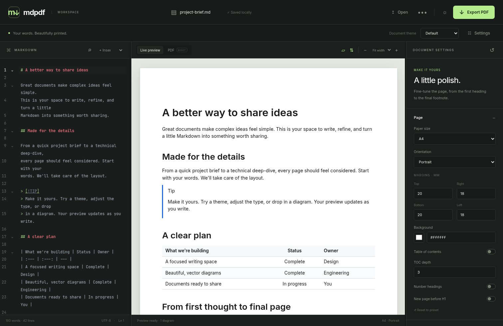

# mdpdf

Markdown to tagged PDF, built with Rust, Leptos and Chromium. Write in CodeMirror, see a sandboxed live preview, customize the document, and download a PDF with selectable text and vector Mermaid diagrams. Preview, web export and CLI use the same core renderer.



Choose **Zen** in the editor or preview toolbar for a distraction-free workspace. Switch between **Read** and **Write** using the small controls at the top right; use **Alt+1** for Read, **Alt+2** for Write, and **Escape** or the close icon to return. Zen follows the interface theme, supports desktop and mobile browsers, and keeps your editing and preview positions.

## Writing tools

Use **Commands** or **Ctrl/Cmd+Shift+P** to find editing and export actions, including in zen mode. **Ctrl/Cmd+B**, **I**, and **K** apply bold, italic, and links to the selection. **Outline** navigates headings; **Insert or edit table** opens a grid with row, column, and alignment controls. Paste spreadsheet cells to create a Markdown table, or paste a URL over selected text to create a link.

**Documents** keeps named drafts in this browser, sorted by recent use. Create, rename, switch documents, or inspect **History** and restore an earlier version. Up to 30 restore points are retained per document. Uploaded images and fonts are cached locally and restored to the server when needed. Browser storage is local to the browser profile and site address; download important documents for backup.

Additional commands include:

- **Document templates**: meeting notes, project briefs, technical specifications, proposals, and reports. Templates create a new document and preserve the current draft.
- **Writing preferences**: spellcheck, editor size, zen column width, typewriter scrolling, optional rich-text paste conversion, and automatic export checks.
- **Markdown checks**: missing image descriptions and broken heading links. The editor also suggests heading anchors and code-fence languages. A selection toolbar provides common formatting actions.
- **Diagram workspace**: edit or insert Mermaid diagrams with live previews, examples, and parse errors before applying changes.
- **Export preflight**: check print layouts for missing images, failed diagrams, and likely clipping. Export runs the check automatically; review issues, jump to source, or export anyway. Strict diagram export rules still apply.
- **Find in rendered document**: use the command, the reading-mode search icon, or Ctrl/Cmd+F inside reading mode. Reading mode also provides copy-code and enlarge controls.
- **Export/Import document bundle**: move a ZIP containing Markdown, theme settings, and referenced uploaded images/fonts between browsers. Import creates a new document; it checks the manifest and asset checksums first. Bundles use standard uncompressed ZIP entries; import expects that mdpdf format. Remote image URLs remain remote references.

## Library, assets, and multiple tabs

The document library searches names, Markdown content, folders, and tags. Pin documents to keep them first, use **Organize** to set a folder and comma-separated tags, and filter the list by folder, tag, or pinned status.

**Asset manager**, available from Commands and the document menu, previews uploaded images and fonts. Rename assets for display, save image descriptions, insert existing images, apply descriptions to image references in the current document, or choose a font for body text. The unused filter includes references in saved history and current edits; assets are retained for recovery.

Each tab keeps its own active document and recovery buffer. Saves compare revisions in a single database transaction. If another tab saves conflicting content, an on-screen notice offers a side-by-side review. Load the saved version or keep your draft as a new document; changed local text is also saved as a recovery copy in the library. This protects browser tabs sharing the same site and profile; it is not synchronization between devices.

Dialogs have accessible names and return focus to their opener. The command palette announces its selected result and supports arrow keys, Enter, and Escape. Table controls identify their row/column, outline expansion uses separate keyboard buttons, and tool controls provide visible focus and larger touch targets.

## Run locally

Install Rust 1.91.1 or newer, Node.js 22+, Chromium and Poppler (for verification). Then:

```sh
rustup target add wasm32-unknown-unknown
cargo install cargo-leptos --version 0.3.6 --locked
npm ci --ignore-scripts
npm run dev
```

Open **http://127.0.0.1:3000**. Set `CHROME_PATH` if Chromium is not on PATH. `npm run dev` bundles the pinned editor, builds native and WASM targets, and starts the app. Use `cargo leptos watch` for Rust live reload after `npm run vendor`.

The browser WASM uses the optimized `wasm-release` profile in development too. Markdown parsing and syntax highlighting run in a background Rust/WASM worker. Live updates retain the sandbox, fonts and unchanged rendered blocks; native delivery supplies image assets and newly needed font subsets. File opens and drops bypass the typing debounce. Text can appear while new font subsets load; diagrams wait for those fonts and stop rendering obsolete documents when you switch files.

Production builds:

```sh
npm run vendor
cargo leptos build --release
cargo build --release --locked -p mdpdf-cli
LEPTOS_SITE_ROOT=target/site target/release/mdpdf-app
```

The `justfile` provides equivalent `dev`, `build`, `test`, `browser-test`, `visual` and Docker recipes.

## Use the workspace

- Open or drop Markdown; insert tables, Mermaid templates, images, page breaks and a TOC from the snippet menu. Paste images directly into the editor.
- Drafts, saved themes and UI preferences stay in browser storage. Uploads stay in a private cookie-scoped session on this server; keep the same browser session to reopen them.
- Change any theme field in Settings, reset a section, select a preset, or import/export `.mdpdf-theme.toml`. CSS compiles locally in WASM. Structural settings also use the shared core locally.
- Upload TTF, OTF or WOFF2 fonts, then choose them for body, headings, code or diagrams. Import `.tmTheme` files under Code blocks.
- Switch between the live HTML preview and the exact PDF. Exact mode refreshes manually or two seconds after editing with auto-refresh enabled. Page guides in live mode are approximate; exact mode shows real pagination.
- Export PDF, Markdown or self-contained HTML. Strict diagrams rejects an export with broken diagrams; normal exports include readable error boxes.
- On small screens, use Editor, Preview and Settings tabs. The interface supports light/dark appearance, resizing, search, zoom and scroll synchronization.

The five presets are Default, GitHub, Academic, Corporate and Compact. Front matter overrides user theme settings. KaTeX math uses `$…$` and `$$…$$`; `cover: true` creates a title page from `title`, `author` and `date`. Enable diagram/image numbering in Settings.

```markdown
---
title: Project notes
author: Ada
cover: true
theme: academic
toc: true
---
# Results

Inline $e^{i\pi}+1=0$.

<!-- pagebreak -->
```

## CLI

```sh
cargo run -p mdpdf-cli -- input.md -o out.pdf --theme academic
cargo run -p mdpdf-cli -- input.md --set tables.style=grid --strict-diagrams --html out.html
cargo run -p mdpdf-cli -- input.md --theme ./custom.mdpdf-theme.toml
```

Without `-o`, output uses the input filename with a `.pdf` extension. `--set` accepts repeated typed dotted fields. Relative image paths resolve from the input file's directory; public HTTP(S) images are fetched and inlined before Chromium starts rendering. Exit code 2 indicates strict diagram errors; other failures use code 1. Strict failures preserve existing output files.

Native binaries embed Mermaid, KaTeX and bundled fonts. They require Chromium, but do not need a source checkout, runtime CDN or frontend server.

## Configuration

| Variable | Default | Purpose |
| --- | --- | --- |
| `CHROME_PATH` | executable discovery | Chromium executable |
| `MDPDF_HOST` | `127.0.0.1` | Listen address |
| `MDPDF_PORT` | `3000` | HTTP port |
| `MDPDF_POOL_SIZE` | `4` | Reusable Chromium tabs, 1–32 |
| `MDPDF_MAX_MD_BYTES` | `2097152` | Markdown limit, at most 2 MB |
| `MDPDF_ASSET_DIR` | `target/uploads` | Session asset storage |
| `MDPDF_ASSET_TTL_HOURS` | `24` | Asset expiration, cleanup hourly |
| `LEPTOS_SITE_ROOT` | `target/site` | Built static files |
| `MDPDF_CONTAINER_NO_SANDBOX` | unset | `1` enables explicit container-only sandbox override |

Chromium's sandbox stays enabled for native runs. The Docker image runs as an unprivileged user, includes its pinned browser and enables the container override. Use a long-lived VM/container with sufficient memory for Chromium.

```sh
docker build -t mdpdf .
docker run --rm -p 3000:3000 --shm-size=1g -v mdpdf-assets:/app/uploads mdpdf
```

`GET /healthz` reports browser readiness. Binary exports use `POST /api/export`; the actual Leptos preview server function is `POST /api/rpc/render_preview`. `/api/preview` is a JSON convenience alias. Both accept `markdown` and `theme`; export also accepts `filename` and `strict_diagrams`. Theme presets are available at `/api/themes`; multipart uploads use `/api/assets`.

Raw HTML is sanitized. Preview has an opaque sandbox origin and nonce CSP. Chromium blocks external requests; the native preparation layer resolves approved images with DNS/IP validation, redirect validation, size caps and timeouts. Exports have a 30-second deadline and two concurrent requests per IP. Images are capped at 10 MB, fonts at 5 MB, session uploads at 100 (including at most 10 custom fonts), and document assets at 64 MB. Custom CSS disallows imports, external URLs and unsafe constructs.

## Verify

```sh
cargo fmt --check
cargo clippy --workspace --all-targets --locked -- -D warnings
cargo test --workspace --locked
cargo check -p mdpdf-core --target wasm32-unknown-unknown --locked
node --test crates/mdpdf-core/tests/bootstrap.test.cjs
python3 scripts/check_assets.py
node scripts/check_browser.cjs
cargo test --workspace --locked -- --ignored --nocapture
npm run test:e2e
```

For reproducible browser/PDF verification, install the exact browser selected by Playwright 1.64.1 (Chromium 156.0.8078.4, revision 1248), and use it for both the server and CLI:

```sh
npx playwright install --with-deps chromium
export CHROME_PATH="$(node -e 'console.log(require("playwright").chromium.executablePath())')"
```

With the app running and CLI built, `node scripts/verify_delivery.mjs` checks CLI/web page counts and extracted text for all 14 required fixtures plus the math/cover fixture, compares their first PDF pages (plus the math equation page) to PNG goldens (≤0.5% changed pixels, channel threshold 16), and times a 30-page document with 20 diagrams. Deliberate visual changes require reviewing outputs and running `UPDATE_GOLDENS=1 node scripts/verify_delivery.mjs`. Results are written to `target/verification/`. Rasterization uses Poppler’s Cairo backend (`pdftocairo`); its Splash backend can omit individual Chromium Type 3 glyphs despite correct vector outlines.

HTML snapshots live alongside core tests; regenerate intentional changes with `INSTA_UPDATE=always cargo test -p mdpdf-core --test pipeline`, review them, then rerun without update mode. Browser tests also check uploaded fonts, image isolation, strict errors, math, cover pages, local structural settings and scroll synchronization. CI runs Rust, browser, PDF, visual and container checks.

With the app running, `node scripts/benchmark_preview.mjs markdown` exercises actual file drops for every `.md` file in that folder. It checks source preservation, diagram completion, iframe reuse and scroll geometry caching, and records content-update and complete-render times in `target/verification/preview-performance.json`. Set `MDPDF_BASE_URL` for another server or pass another sample directory.

See [PROGRESS.md](PROGRESS.md) for actual verification results and environment limits, [DECISIONS.md](DECISIONS.md) for tradeoffs, and [SPEC.md](SPEC.md) for requirements. Vendored assets retain their MIT/OFL notices under `assets/`; container copies include these notices.
