# Mermaid diagram families

## Flowchart

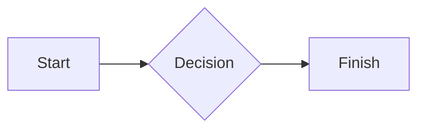

## Sequence

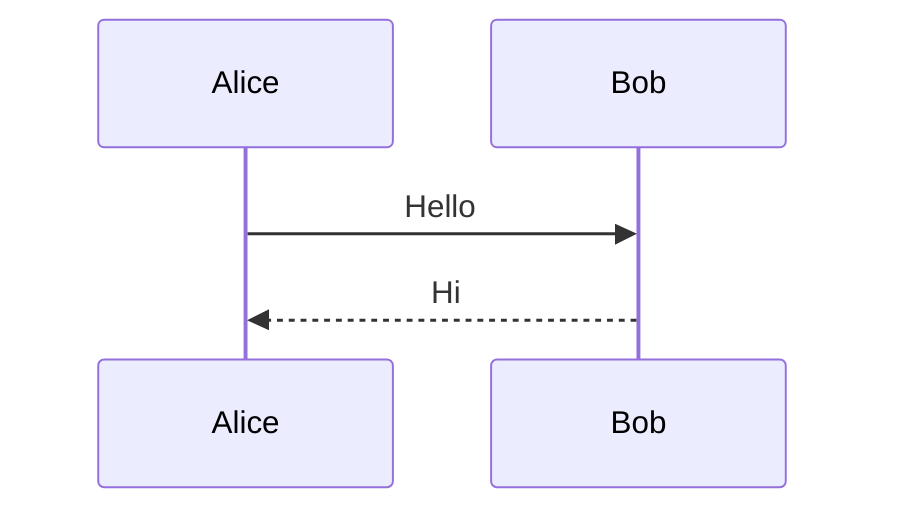

## Class

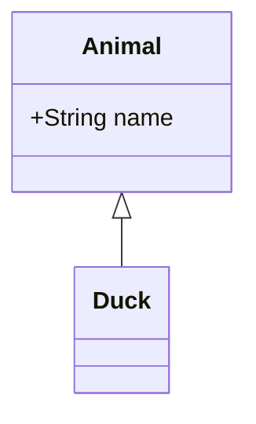

## State

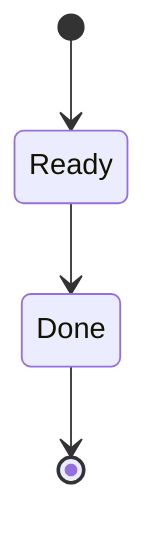

## Entity relationship

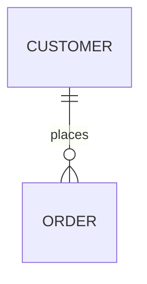

## Gantt

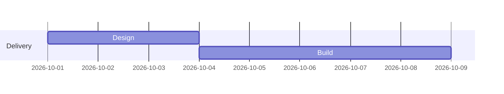

## Pie

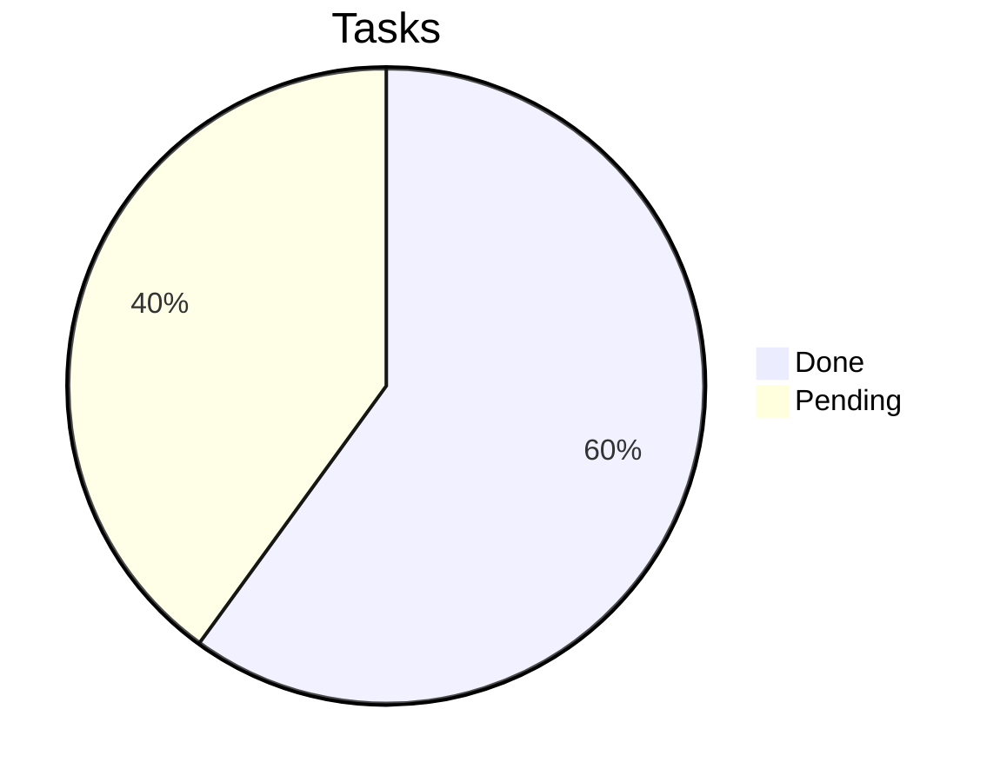

## Journey

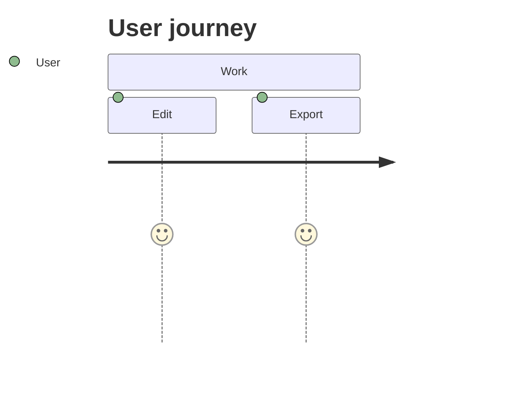

## Git graph

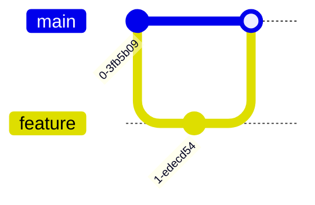

## Mindmap

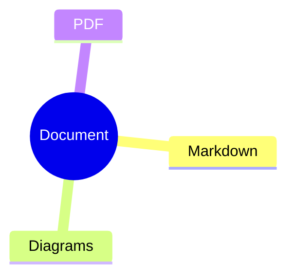

## Timeline

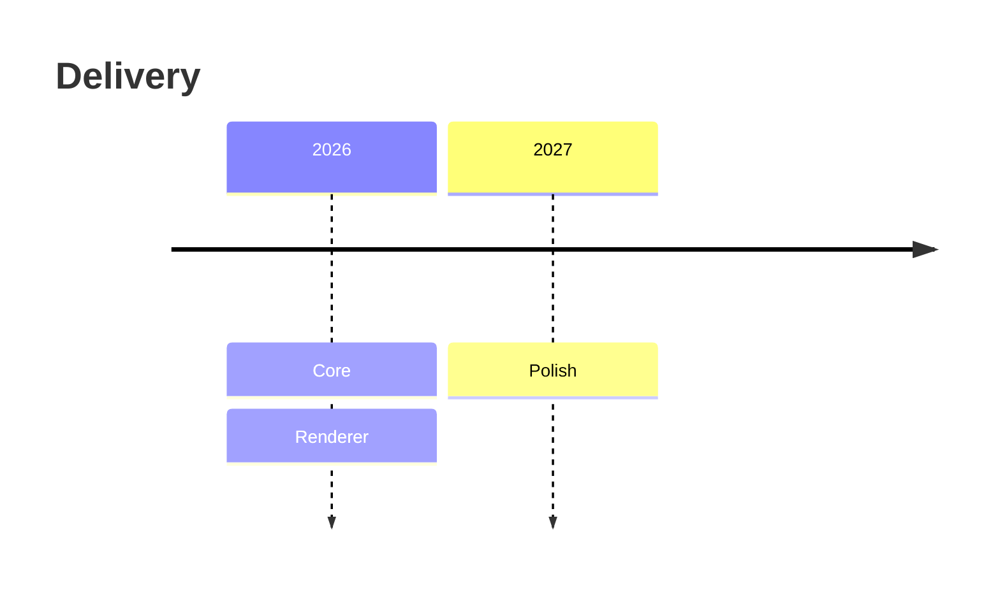

## Quadrant

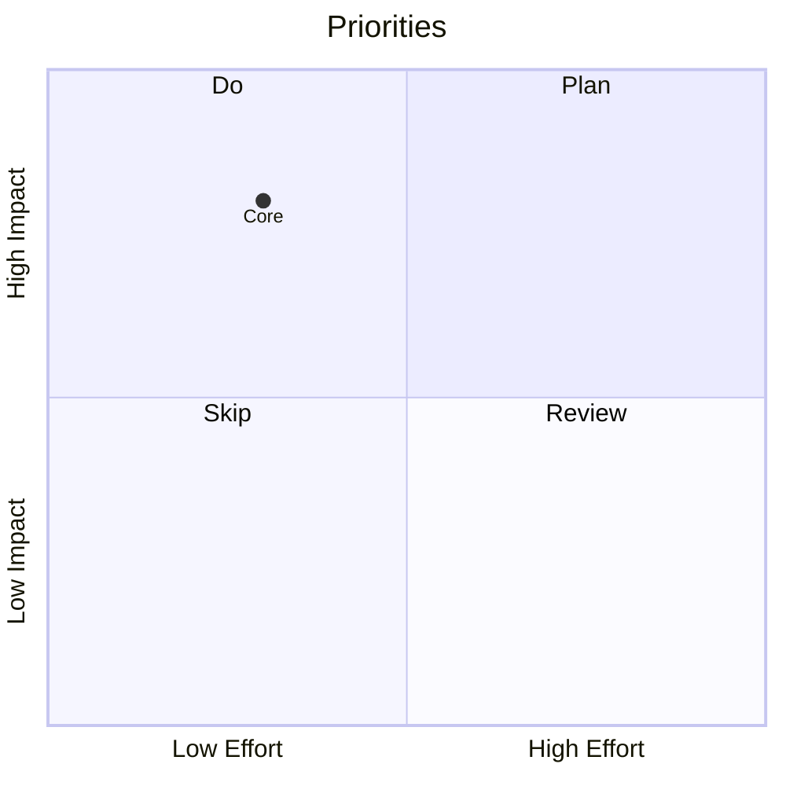

## Sankey

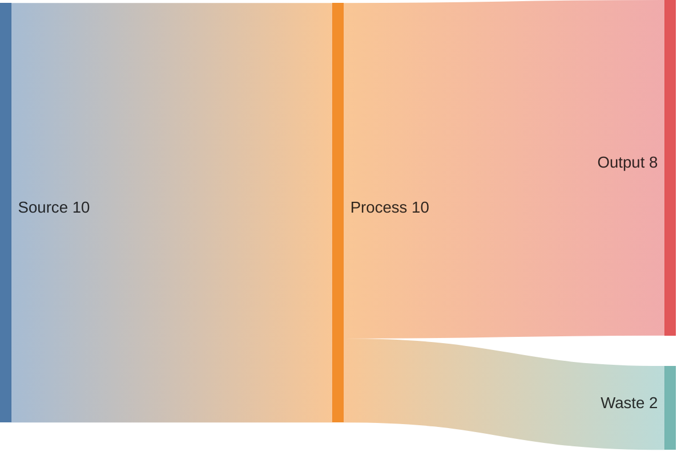

## XY chart

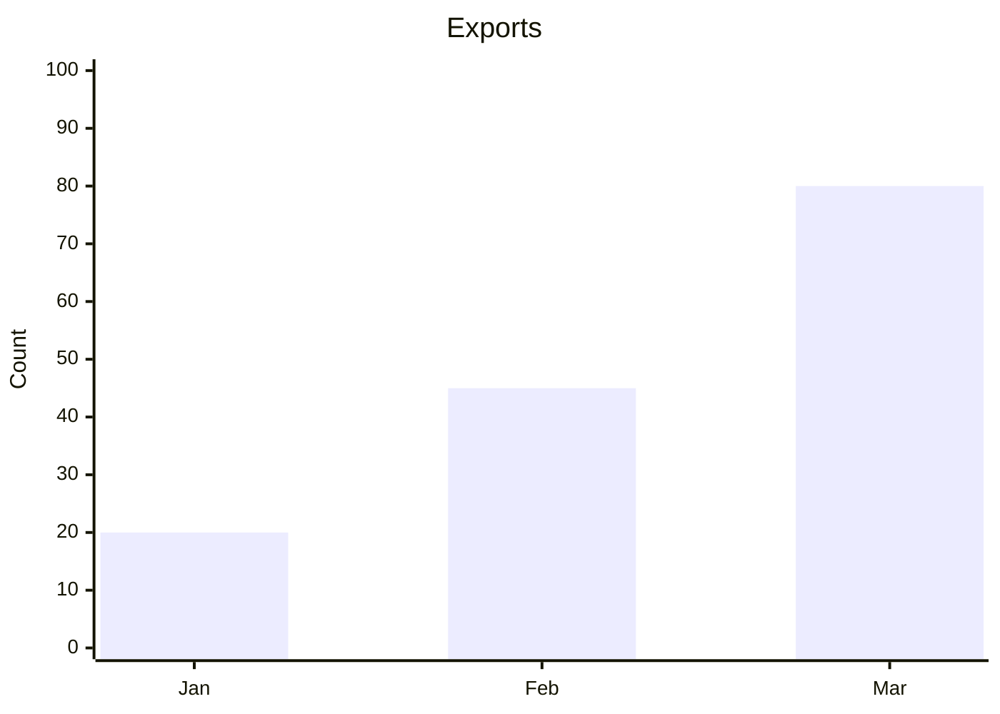

## Block

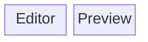

## Architecture

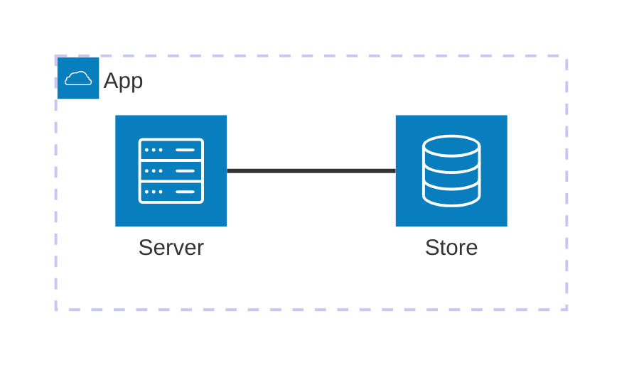

## Requirement

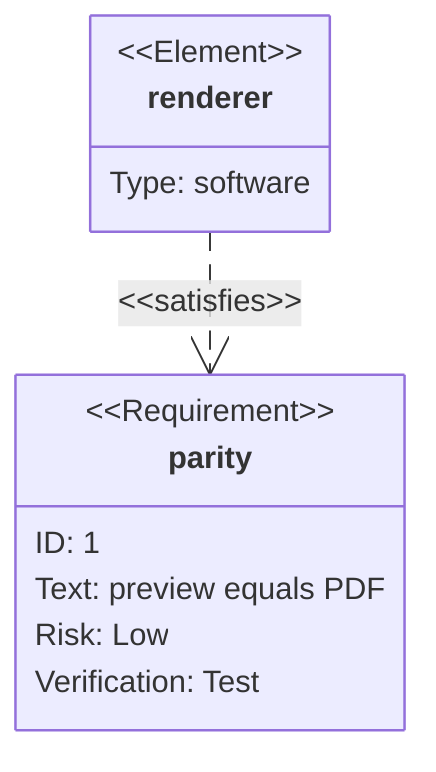

## C4 context

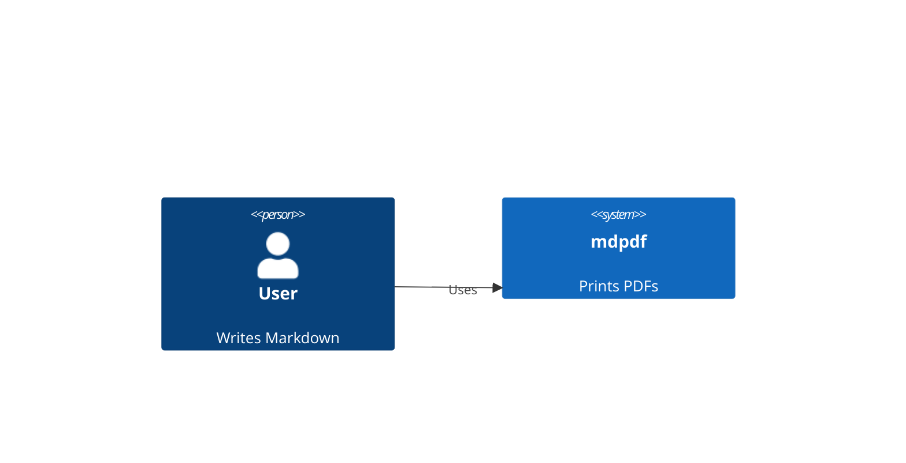

## Packet

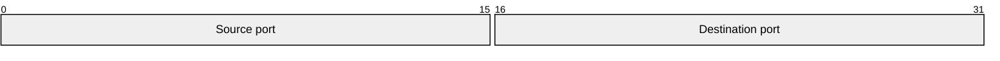

## Kanban

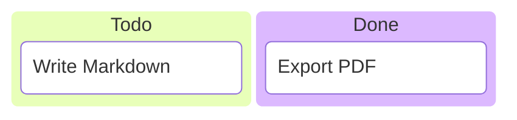

## Radar

```mermaid {caption="Radar"}
radar-beta
  title Skills
  axis r["Read"], w["Write"], p["Print"]
  curve a["App"]{4, 5, 5}
```

## Treemap

```mermaid {caption="Treemap"}
treemap-beta
  "Documents"
    "Reports": 40
    "Notes": 60
```

## Info

```mermaid {caption="Info"}
info
```

## Swimlane

```mermaid {caption="Swimlane"}
swimlane-beta LR
  subgraph Writer
    edit[Edit]
  end
  subgraph Renderer
    print[Print]
  end
  edit --> print
```

## Event modeling

```mermaid {caption="Event modeling"}
eventmodeling
tf 01 ui Editor
tf 02 cmd Export
tf 03 evt Printed
```

## Tree view

```mermaid {caption="Tree view"}
treeView-beta
├── assets/
└── report.md
```

## Ishikawa

```mermaid {caption="Ishikawa"}
ishikawa-beta
    Clipped labels
    Typography
        Font unavailable
    Layout
        Diagram too wide
```

## Railroad primitives

```mermaid {caption="Railroad primitives"}
railroad-beta
export = sequence(terminal("print"), nonterminal("document")) ;
```

## Railroad EBNF

```mermaid {caption="Railroad EBNF"}
railroad-ebnf-beta
export = "print", "document" ;
```

## Railroad ABNF

```mermaid {caption="Railroad ABNF"}
railroad-abnf-beta
export = "print" SP "document" ;
```

## Railroad PEG

```mermaid {caption="Railroad PEG"}
railroad-peg-beta
Export <- "print" "document" ;
```

## Venn

```mermaid {caption="Venn"}
venn-beta
  set Preview
  set PDF
  union Preview,PDF["Shared renderer"]
```

## Wardley

```mermaid {caption="Wardley"}
wardley-beta
title Document pipeline
anchor Reader [0.9, 0.5]
component Renderer [0.6, 0.7]
Reader -> Renderer
```

## Cynefin

```mermaid {caption="Cynefin"}
cynefin-beta
  clear
    "Apply preset"
  complicated
    "Tune typography"
  complex
    "Explore layout"
  chaotic
    "Recover browser"
```
